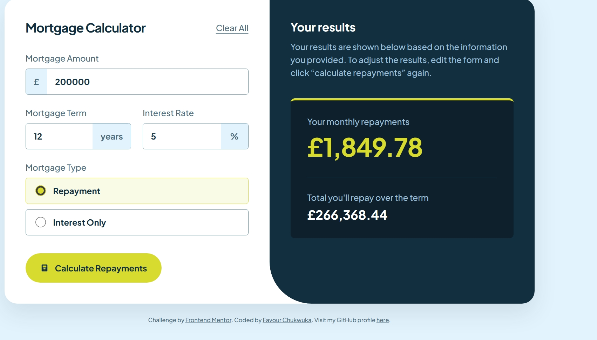

# Frontend Mentor - Mortgage repayment calculator solution

This is a solution to the [Mortgage repayment calculator challenge on Frontend Mentor](https://www.frontendmentor.io/challenges/mortgage-repayment-calculator-Galx1LXK73). Frontend Mentor challenges help me improve my coding skills by building realistic projects.

## Table of contents

  - [Overview](#overview)
  - [The challenge](#the-challenge)
  - [Screenshot](#screenshot)
  - [Links](#links)
  - [My process](#my-process)
  - [Built with](#built-with)
  - [What I learned](#what-i-learned)
  - [Continued development](#continued-development)
  - [Useful resources](#useful-resources)
  - [Author](#author)
  - [Acknowledgments](#acknowledgments)

## Overview

### The challenge

Users should be able to:

- Input mortgage information and see monthly repayment and total repayment amounts after submitting the form
- See form validation messages if any field is incomplete
- Complete the form only using their keyboard
- View the optimal layout for the interface depending on their device's screen size
- See hover and focus states for all interactive elements on the page

### Screenshot



### Links

- Solution URL: Add your Frontend Mentor solution URL here
- Live Site URL: Add your live site URL here

## My process

### Built with

- Semantic HTML5 markup
- CSS custom properties
- CSS Grid
- Flexbox
- JavaScript
- DOM manipulation
- Form validation
- Responsive web design
- Mobile-first workflow

### What I learned

Working on this project helped me understand how HTML, CSS, and JavaScript work together to build an interactive website.

I improved my understanding of semantic HTML by using elements such as forms, labels, inputs, fieldsets, and legends to structure the calculator.

I also practised using CSS Grid, Flexbox, custom properties, and media queries to style the calculator and make it responsive across different screen sizes.

One of my major learning experiences was using JavaScript to collect user input, validate form fields, handle events, perform mortgage calculations, and display results dynamically.

I also learned how to use CSS custom properties to maintain consistent colours throughout a project.

```css
:root {
  --lime: hsl(61, 70%, 52%);
  --red: hsl(4, 69%, 50%);
  --white: hsl(0, 0%, 100%);
}
```

### Continued development

I want to continue improving my JavaScript skills, particularly DOM manipulation, functions, event handling, and form validation.

I also want to become more confident writing JavaScript independently, understanding mathematical calculations in code, and building responsive websites with clean and organised code.

### Useful resources

- [Frontend Mentor](https://www.frontendmentor.io/) - This provided the challenge, design references, and requirements for the project.
- [MDN Web Docs](https://developer.mozilla.org/) - This helped me understand HTML, CSS, and JavaScript concepts.
- [The Markdown Guide](https://www.markdownguide.org/) - This helped me understand how to structure and format README files.


## Author

- Website - Add your website URL here
- Frontend Mentor - Add your Frontend Mentor profile URL here
- GitHub - [@chuksfavour5190-stack](https://github.com/chuksfavour5190-stack)

## Acknowledgments

I would like to acknowledge Frontend Mentor for providing the challenge and design resources that helped me practise my frontend development skills. I also appreciate the learning support and explanations that helped me understand the concepts used throughout this project.